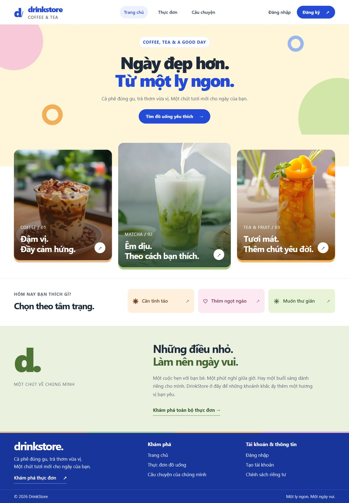
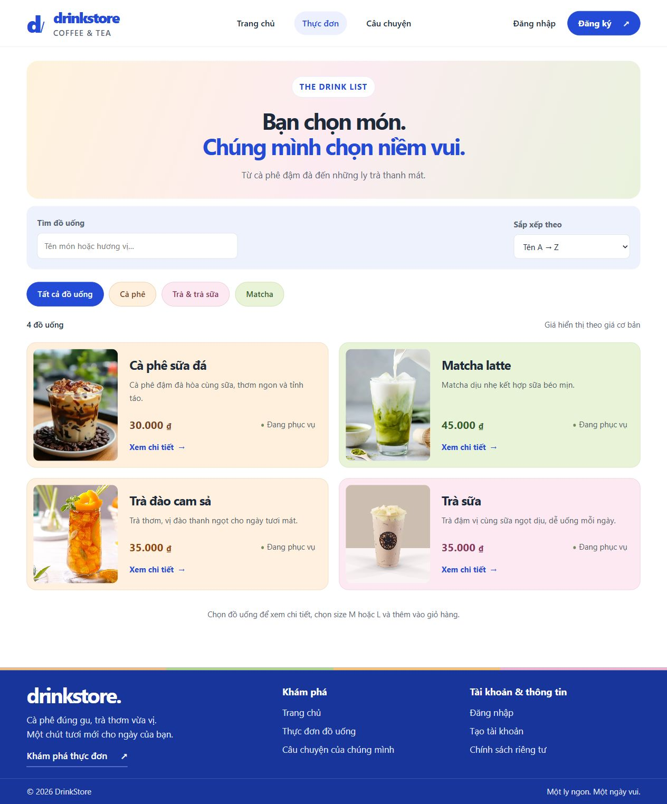
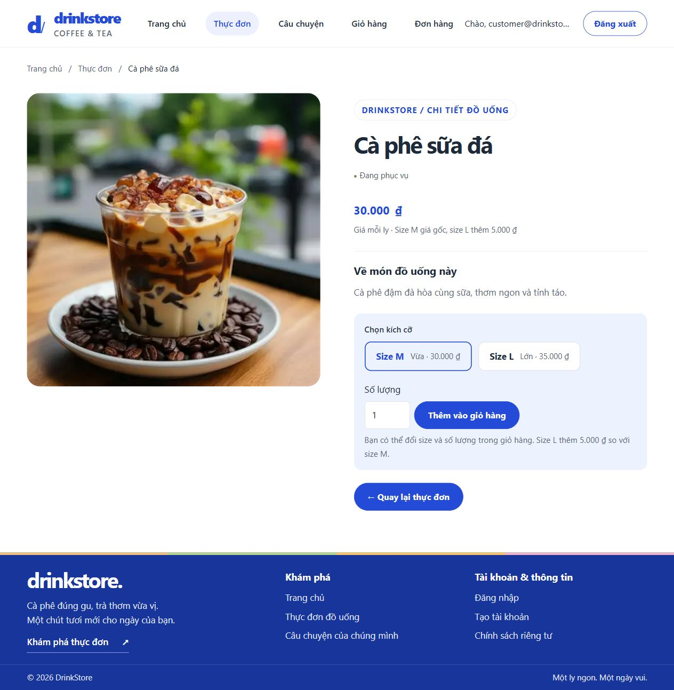
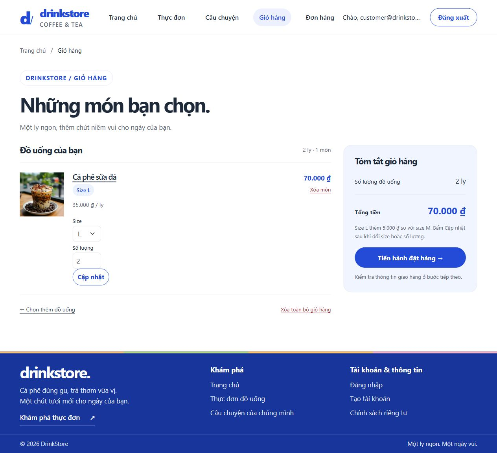
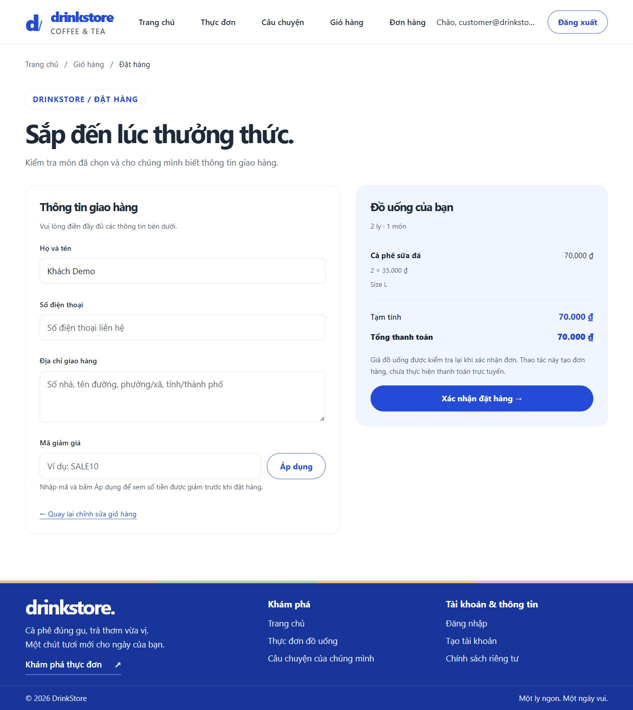
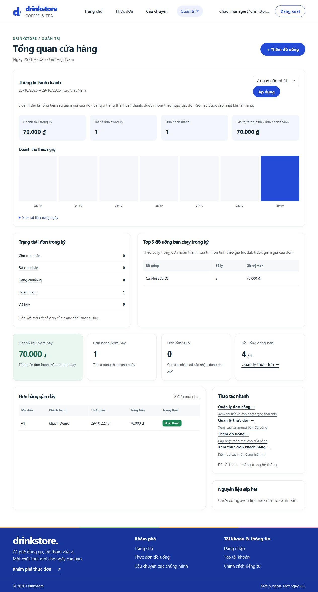

# DrinkStore

Website đặt đồ uống và quản lý cửa hàng, xây dựng bằng ASP.NET Core MVC. Khách hàng có thể chọn món, chọn size, đặt hàng và theo dõi đơn. Quản lý có thể cập nhật thực đơn, công thức pha chế, nguyên liệu, mã giảm giá và trạng thái đơn hàng.

## Giao diện

Ảnh chụp từ ứng dụng đang chạy với database demo. Tài khoản và đơn hàng trong ảnh đều là dữ liệu minh họa.

### Trang chủ



### Thực đơn



<details>
<summary>Xem chi tiết đồ uống, giỏ hàng, đặt hàng và trang quản lý</summary>

### Chi tiết đồ uống



### Giỏ hàng



### Đặt hàng



### Quản lý



</details>

## Chức năng

- Đăng ký, đăng nhập và phân quyền `Customer` / `ShiftManager` bằng ASP.NET Core Identity.
- Tìm kiếm đồ uống, lọc theo hương vị, sắp xếp theo tên hoặc giá.
- Chọn size M/L; size L cộng 5.000 đồng so với giá cơ bản.
- Giỏ hàng theo session, cập nhật size và số lượng, áp dụng mã giảm giá khi đặt hàng.
- Tạo đơn hàng, xem lịch sử và theo dõi trạng thái.
- Quản lý thực đơn, nguyên liệu và công thức theo từng size.
- Xác nhận đơn, chuyển sang pha chế, hoàn tất hoặc hủy theo trạng thái được phép.
- Trừ nguyên liệu theo công thức khi chuyển từ xác nhận sang pha chế.

**Hiện tại thao tác đặt hàng chỉ tạo đơn, chưa tích hợp thanh toán trực tuyến.**

## Công nghệ và yêu cầu

- .NET 10 SDK.
- ASP.NET Core MVC, Razor Views, ASP.NET Core Identity.
- Entity Framework Core 10.0.13 và SQL Server.
- HTML, CSS, JavaScript, Bootstrap.
- Để chạy theo hướng dẫn nhanh bên dưới: Windows, PowerShell và SQL Server Express đang chạy. Có thể dùng SQL Server LocalDB thay thế.

Không cần nhận database thật của tác giả. Repo có sẵn migrations và chế độ tạo dữ liệu demo.

## Chạy nhanh với dữ liệu demo

Clone repo rồi mở PowerShell tại thư mục gốc:

```powershell
git clone https://github.com/QuangVinh205/DrinkStore.git
cd DrinkStore
.\scripts\Start-Demo.ps1
```

Script sẽ hỏi mật khẩu quản lý demo. Chọn mật khẩu có ít nhất 8 ký tự, gồm chữ hoa, chữ thường và số; mật khẩu không được lưu vào source. Nếu máy chặn script PowerShell, dùng cách cấu hình thủ công ở phần tiếp theo.

Nếu dùng LocalDB, khởi động instance rồi chỉ định server:

```powershell
sqllocaldb start MSSQLLocalDB
.\scripts\Start-Demo.ps1 -Server '(localdb)\MSSQLLocalDB'
```

Ứng dụng tự áp dụng migrations vào database **`DrinkStoreDemo`**, tạo 4 đồ uống, 5 nguyên liệu, 8 công thức cho size M/L và tài khoản quản lý:

- Website: [http://localhost:5062](http://localhost:5062).
- Quản lý: `manager@drinkstore.example`, dùng mật khẩu vừa nhập.
- Khách hàng: chọn **Đăng ký** trên web để tạo tài khoản mới, sau đó thử thêm món và đặt hàng.

Tài khoản SQL/Windows cần có quyền tạo database. Khi chạy lại, dữ liệu menu demo có sẵn được giữ nguyên; mật khẩu quản lý đã tạo cũng không bị đổi theo mật khẩu nhập lại. Nhấn `Ctrl+C` để dừng web.

Chế độ demo chỉ chạy trong `Development` và bắt buộc dùng tên database `DrinkStoreDemo`. Ứng dụng từ chối chạy demo với `DrinkStoreDb` hoặc môi trường Production.

### Cấu hình demo thủ công

Chạy trong PowerShell tại thư mục gốc; các biến chỉ có hiệu lực trong phiên terminal hiện tại:

```powershell
$env:ConnectionStrings__DrinkStoreConnection = 'Server=.\SQLEXPRESS;Database=DrinkStoreDemo;Trusted_Connection=True;TrustServerCertificate=True;'
$env:Demo__Enabled = 'true'
$demoPassword = Read-Host 'Mật khẩu quản lý demo' -AsSecureString
$env:Demo__ManagerPassword = [Net.NetworkCredential]::new('', $demoPassword).Password
dotnet run --project .\DrinkStore --launch-profile http
```

Đóng terminal này sau khi thử demo, hoặc xóa ba biến môi trường trên trước khi chuyển sang cấu hình khác.

## Chạy với database riêng

Mặc định `DrinkStore/appsettings.json` dùng SQL Server Express tại `.\SQLEXPRESS`, database `DrinkStoreDb`, xác thực Windows. Khóa cấu hình ứng dụng sử dụng là **`ConnectionStrings:DrinkStoreConnection`**.

Trong một terminal mới, có thể ghi đè kết nối bằng biến môi trường thay vì sửa source:

```powershell
$env:ConnectionStrings__DrinkStoreConnection = 'Server=.\SQLEXPRESS;Database=DrinkStoreDb;Trusted_Connection=True;TrustServerCertificate=True;'
dotnet restore

# Chỉ cài nếu chưa có dotnet-ef; nếu đã cài, kiểm tra bằng dotnet ef --version.
dotnet tool install --global dotnet-ef --version 10.0.13
dotnet ef database update --project .\DrinkStore
dotnet run --project .\DrinkStore --launch-profile http
```

Chế độ thông thường tạo các role khi khởi động, nhưng không tự thêm đồ uống hay tài khoản quản lý. Tài khoản đăng ký trên web nhận role `Customer`. Dùng chế độ demo phía trên nếu cần thử ngay trang quản lý.

`Trusted_Connection=True` sử dụng tài khoản Windows trên máy người chạy. `TrustServerCertificate=True` trong ví dụ dành cho môi trường phát triển cục bộ. Nếu dùng SQL Authentication, giữ thông tin đăng nhập ở biến môi trường hoặc kho bí mật của môi trường chạy, không commit mật khẩu vào repo.

## Kiểm tra

```powershell
dotnet build .\DrinkStore
dotnet run --project .\tests\DrinkStore.SmokeTests
```

Smoke tests kiểm tra xử lý giỏ hàng, đổi/gộp size, giới hạn số lượng và phụ thu size L; không cần SQL Server. Các kiểm tra này chưa bao phủ toàn bộ luồng database hoặc giao diện.

## Cấu trúc chính

```text
DrinkStore/
  Areas/Admin/       Trang và controller quản lý
  Controllers/       Trang chủ, tài khoản, thực đơn, giỏ hàng, đặt hàng
  Data/              DbContext, khởi tạo role và dữ liệu demo
  Migrations/        Lịch sử thay đổi cấu trúc database
  Models/            Đồ uống, đơn hàng, nguyên liệu, công thức...
  Services/          Xử lý kho và giao diện cổng thanh toán
  ViewModels/        Dữ liệu cho form và giao diện
  Views/             Razor Views
  wwwroot/           CSS, JavaScript và hình ảnh
docs/screenshots/    Ảnh chụp giao diện
scripts/            Script chạy demo
tests/              Smoke tests giỏ hàng
```

## Lỗi thường gặp

- **Không kết nối được SQL Server:** kiểm tra SQL Server đang chạy, tên instance và khóa `DrinkStoreConnection`. Với LocalDB, dùng `sqllocaldb start MSSQLLocalDB`.
- **Báo thiếu bảng:** chạy `dotnet ef database update --project .\DrinkStore`, hoặc chạy demo để ứng dụng tự áp dụng migrations.
- **Menu trống:** database mới chỉ có cấu trúc; chạy demo để có dữ liệu minh họa.
- **Không vào được trang quản lý:** cần tài khoản có role `ShiftManager`. Tài khoản khách không có quyền này.
- **Demo từ chối khởi động:** kiểm tra môi trường Development, tên database phải là `DrinkStoreDemo`, và mật khẩu đáp ứng quy tắc ở trên.
- **Cổng 5062 đang được dùng:** dừng phiên DrinkStore cũ trước khi chạy lại.

## Khi chia sẻ source

Giữ migrations, ảnh trong `wwwroot`, README và script demo. `.gitignore` loại cấu hình Codex cá nhân, file tạm, file môi trường, kết quả build và các định dạng database/backup phổ biến. Luôn kiểm tra `git diff --cached` trước khi push; không thêm database thật, mật khẩu hoặc dữ liệu khách hàng vào repo.
